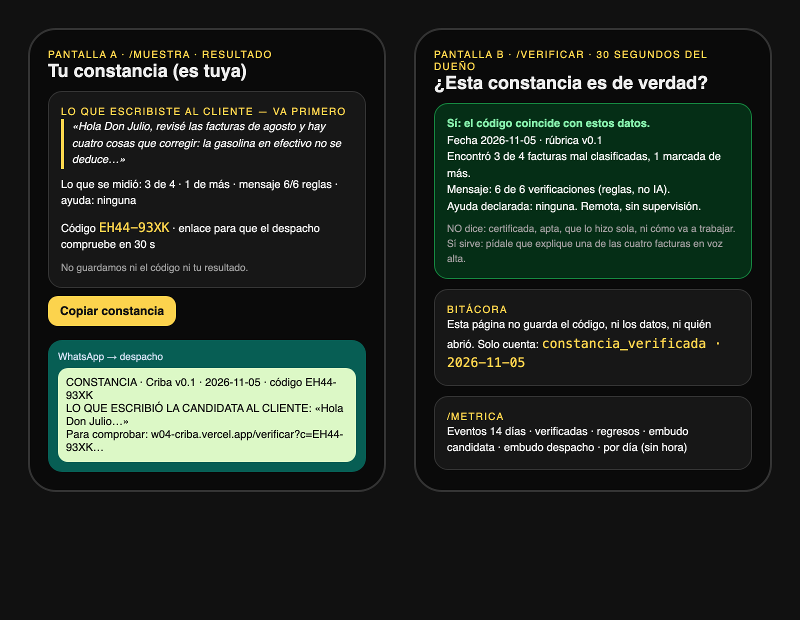
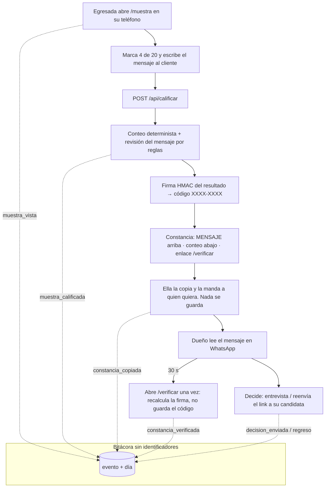
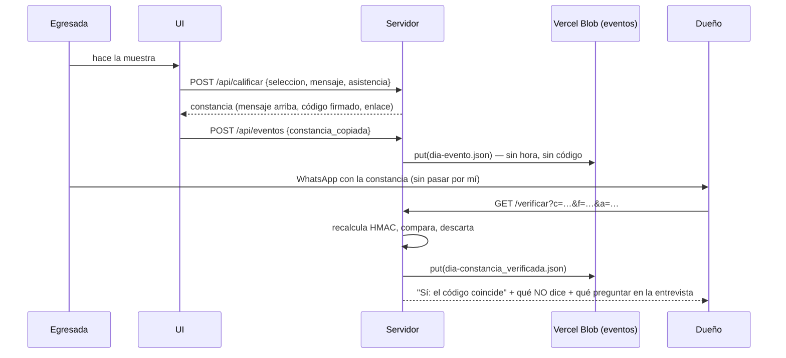

# Packet — Semana 13 · Criba (venture) · "Cinco usuarios que no me quieren"

> Escrito ANTES del código de esta semana (2026-11-05, después del Brain Bending). Semana 13 · venture week · T8 · lente USER · Andrés Álvarez Morphy Namnum. El packet de la semana 4 (primer build) quedó en `docs/PACKET-w04.md`.

## El problema, en mis palabras

Criba lleva 60 días en vivo y nadie real la ha usado: el tablero está en 0 de 20 porque nunca le mandé el link a un dueño. Lo único que sé del dueño de despacho (su semana seis, su cuñada, que no abre links) es inferencia mía. Esta semana el producto deja de ser una idea probada con un usuario sintético y se pone delante de cinco personas de su mundo, tres de ellas desconocidas. Lo que me enseñen sus trabas y sus palabras exactas decide el fix; mi preferencia no.

La pelea de hoy movió el producto antes de las sesiones (hipótesis #2, declarada): el dueño no entra por la portada, recibe la constancia por WhatsApp, y lo que juzga es el **mensaje que la candidata le escribió al cliente**, no el "3 de 4" (ese lo saca un modelo igual). La constancia nueva lleva el mensaje arriba, el conteo abajo, y un código firmado para comprobar en 30 segundos que no se editó, sin que el servidor guarde nada.

## Usuario exacto

- **Usuario de record: el dueño o encargado de un despacho contable de 1–20 personas, sin RH, con vacante de auxiliar contable abierta ESTA semana** (sale de anuncios en OCC/Computrabajo). Su "no" mata el 10:1; su reenvío del link a una candidata real es el único compromiso que cuesta algo.
- **Segundo usuario: la egresada de contaduría sin experiencia** (UVM/UNITEC/UAEH), desde su teléfono, por WhatsApp. Si no termina la muestra, el dueño nunca ve nada.
- Las dos predicciones escritas antes de las sesiones (se rompen en público):
  - Dueño: lee el mensaje de la candidata en WhatsApp; NO toca el enlace de verificar; cuando dice "sí, la entrevisto" y le pido que reenvíe el link a su candidata delante de mí, dice "luego".
  - Egresada: llega al final de las 20 tarjetas, abre el cuadro del mensaje y escribe menos de 40 palabras (el mínimo de la rúbrica) y cierra.

## Definición de éxito

**Antes de que cierre el módulo:** (1) cinco sesiones documentadas (rol, tarea, dónde se trabó, citas exactas, columna observado/declarado/compromiso); (2) las 3 peores fallas ordenadas por amenaza al 10:1 con la regla escrita antes (nivel 1 = impide que un dueño diga sí; nivel 2 = impide que una egresada termine; nivel 3 = lo demás), ordenadas por alguien que no soy yo; (3) la falla #1 corregida y redesplegada, con capturas antes/después; (4) un usuario que vuelve con prueba (mensaje del dueño "ya se lo mandé" o evento `regreso`); (5) la bitácora de eventos viva en /metrica con datos reales y sin identificadores; (6) la URL de registro carga.

## Mockup (generado)

*Generado por código (HTML → Playwright) antes de escribir la app.*

## Flujo

## Benchmark

**La mejor solución existente en el mundo para esto es** Applied (Reino Unido, BIT): la muestra de trabajo anonimizada corre dentro del pipeline del empleador y reemplaza el filtro de CV (en el piloto de BIT, >50% de los contratados no habrían pasado el CV). **La mía difiere/localiza en** que el despacho de 4 no tiene pipeline ni 700 solicitantes: Criba no reemplaza un filtro, reemplaza la semana seis de una mala contratación, entra como un link en WhatsApp antes de la entrevista que el dueño ya iba a hacer, y lo que el dueño juzga es el mensaje de la candidata con su propio criterio, no una calificación de máquina.

## Vista larga (3 oraciones)

Si esta rebanada funciona, en tres años Criba es el mensaje que una egresada manda antes del CV y que un despacho reconoce porque ya le sirvió una vez: una constancia firmada que él lee en 30 segundos y una pregunta de entrevista que no se falsifica con un modelo. Los muros de carga son la rúbrica pública, la firma sin almacenamiento (el servidor nunca guarda una constancia ni un código) y la bitácora que cuenta días y nunca personas. Lo que la mata es lo mismo que la mataría hoy: que ningún dueño cuente una semana seis con sus palabras.

## Lo que NO construyo esta semana

- Rotación de juegos de facturas (v0.2): la clave de respuestas cabe en un WhatsApp (kill propio, entregado al Adversario); queda como deuda declarada en /rubrica.
- Revisión del mensaje con modelo de lenguaje real: sigue por reglas, etiquetada.
- Cuentas, base de datos, grabación de sesiones (Clarity/Hotjar): un grabador guardaría las respuestas de la candidata.
- Pago de nadie: los MX$400 de la egresada mueren esta semana como BET; se mide dolor, no precio.
- Un enlace por dueño para rastrear reenvíos: uniría dueño con constancia.

## Arquitectura y stack

| Capa | Qué | Por qué |
|---|---|---|
| Web | Next.js 15 (App Router, JS) + Tailwind 4, Vercel | el mismo stack de las 9 naves |
| Firma | `lib/firma.js` — HMAC-SHA256 sobre fecha·versión·aciertos·falsos·checks·asistencia → 8 chars (sin 0/O/1/I); secreto en Vercel env `CONSTANCIA_SECRET`; sin secreto → constancia "SIN CÓDIGO" | verificar sin guardar: Condición 5 |
| Verificación | `/verificar?c=…&f=…` recalcula y compara; no guarda código ni campos | 30 segundos del dueño |
| Eventos | `lib/eventos.js` + `POST /api/eventos` {evento, pantalla} lista cerrada → Vercel Blob `w04-criba/eventos/DIA-evento.json` (sin hora) | piso de la semana; shadow: el día, nunca la hora ni el código |
| Métrica | `/metrica` conteos, embudos, por día; "lo que este log nunca hace" | honestidad renderizada |
| Regreso | `/volver` cuenta `regreso` sin saber quién | prueba barata de segunda visita |
| Tests | `node --test` (firma, eventos, calificación) + Playwright contra producción (390 px) | pase mecánico |

## Plan de pruebas

1. Unitarias: `firmar` es determinista y cambia con cualquier campo; `verificar` rechaza código editado y campos editados; `validar` rechaza eventos fuera de lista, campos extra; `resumirEventos` cuenta por día.
2. Mecánica (Playwright vs prod, 390 px): hacer la muestra → constancia con mensaje arriba y código → abrir el enlace de verificar → "Sí"; editar un dígito → "No"; /metrica muestra los eventos del día; POST con evento inventado → 400; ningún request lleva el texto del mensaje a /api/eventos.
3. Persona (capa 1, antes de las sesiones): egresada sintética en 6 pulgadas; predicción: <40 palabras en el cuadro.
4. Sesiones (capa 2): 5 personas, 3 dueños con vacante abierta + 2 egresadas de grupos de Facebook, protocolo Krug/Mom Test (3 min su vida · 12 min tarea en silencio · 3 min compromiso); log por sesión; ranking por alguien que no soy yo; fix #1; redeploy; antes/después.
