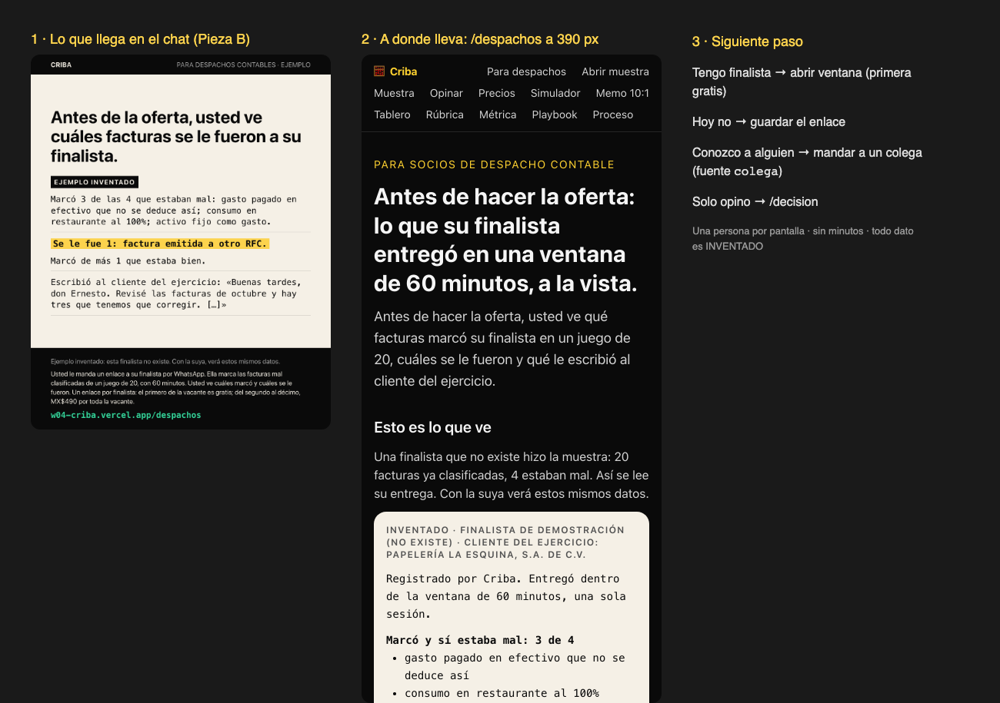
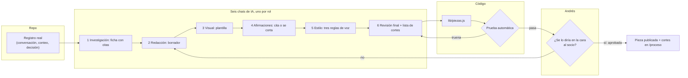
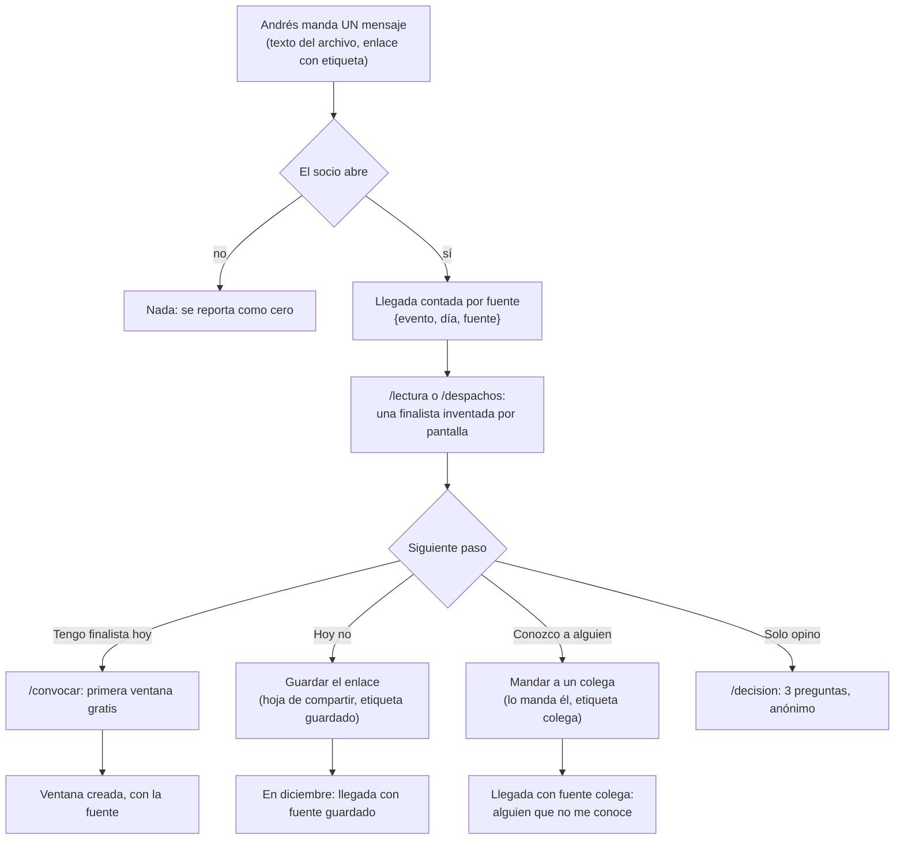

# PACKET — Criba · Semana 15 · DISTRIBUCIÓN: el método alimenta al público

> Packet antes del código (2026-11-19). Viene del Brain Bending de hoy (`w15-fight/`, lente OPERATOR, T1). Los packets anteriores están en `PACKET-w04.md`, `PACKET-w13.md` y `PACKET-w14.md`; aquí solo va lo que este sprint cambia. El Blueprint T1 de la semana 14 sigue vigente (cláusula sombra: *no paid promise of certainty*); cuando exista el de la semana 15, reviso sus condiciones contra esta página y contra la app.

## El problema, en mis palabras
Criba tiene producto y precio, y nadie que no me conozca ha recibido nunca un enlace. Lo que se sabe de personas reales: una conversación de precio con el dueño de un despacho (2026-11-15, WhatsApp), una respuesta de cinco mensajes en frío de LinkedIn (dicho mío; el texto literal no está en el repo) y 0 de 20 en el tablero desde septiembre. Además, la portada le habla a la candidata, que nunca paga. Esta semana Criba decide a quién le habla primero, en qué momento, qué le promete con evidencia y qué no le promete, y arma un proceso que convierte un dato del repo en una pieza útil que se puede auditar.

## Usuario exacto
- **Primer público, usuario y pagador:** el socio o dueño de un despacho contable de 1 a 20 personas, sin RH, que lee él mismo lo que sale de su despacho.
- **El momento:** la tarde después de las primeras entrevistas, con una o dos finalistas y antes de hacer la oferta. Yo no puedo ver ese día (publicar una vacante se ve; tener finalistas no).
- **Lo que hace hoy:** "la contrato y veo". El periodo de prueba decide; el único dato real dice que se enteró en la semana 2–3.
- **Quien entrega y nunca paga:** la finalista.
- **A quién NO le hablo todavía:** candidatas (Condición 1 del Charter; con el tablero en 0 de 20 sería fabricar constancias que nadie pidió) · RH corporativo (segmento supuesto, cero vistos; quien contrata por decenas pide ranking y la Condición 6 lo prohíbe) · negocio sin contador adentro (no puede leer la pantalla con su oficio y pediría "apta o no apta") · universidades y bolsas de trabajo (quien abre la ventana debe ser quien duda).

## Definición de éxito (antes de que cierre el módulo)
1. **`/despachos` en vivo:** página para el socio con la primera línea nueva, la promesa, la pantalla que va a ver (una sola finalista inventada) y cuatro siguientes pasos que funcionan: abrir una ventana, guardar el enlace, mandarlo a un colega, opinar en 2 minutos.
2. **`/lectura` en vivo (Pieza A, interactiva):** el socio hace SU tarea, que es leer una entrega, no clasificar facturas. Termina eligiendo qué le preguntaría a la finalista.
3. **Pieza B (imagen 1080×1350) y Pieza C (texto)** terminadas. Tres piezas, tres formatos, una por serie. Otros tres conceptos quedan como bocetos con propósito.
4. **`/playbook` en vivo:** público, momento, promesa, la promesa que no hago, tres reglas de voz, una línea débil reescrita, paleta, jerarquía tipográfica, plantilla visual, seis conceptos en tres series, la regla de envío, el pre-registro de la prueba y los resultados leídos del log (con sus ceros).
5. **`/proceso` en vivo:** los seis roles con entrada, salida y chequeo; el rastro real de una pieza (dato del repo → método → pieza); lo que la revisión cortó; y el estado de la aprobación humana.
6. **La prueba automática de afirmaciones** corre antes de cada deploy y rechaza las cinco frases que yo mismo escribí hoy y que el Charter prohíbe.
7. **El log cuenta por fuente** (lista cerrada) sin identidad: llegadas, lecturas terminadas, compartir abierto, ventanas creadas.
8. Decisión de sombra aplicada: **nunca dos finalistas en la misma pantalla** y el tiempo ya no sale en minutos.
9. Un bug encontrado y corregido en el pase mecánico, un fix de la prueba de persona, redeploy.

## El playbook de lanzamiento

### Estrategia
| | |
|---|---|
| **Público** | Socio de despacho contable de 1–20, sin RH, que lee él mismo |
| **Necesidad** | Ver algo del trabajo de la finalista antes de la oferta; hoy se entera en la semana 2–3, ya pagando |
| **Posicionamiento** | "No le digo a quién contratar. Le enseño lo que entregó." Frente a una prueba con ranking, Criba pide leer y no da veredicto. A quien quiere una lista ordenada lo pierdo, y no lo intento convencer |
| **Promesa** | "Antes de hacer la oferta, usted ve qué facturas marcó su finalista en un juego de 20, cuáles se le fueron y qué le escribió al cliente del ejercicio." |
| **Evidencia de la promesa** | Cada verbo lo registra la ventana (`/convocar` → `/verificar`), con pruebas automáticas pasando en producción desde la semana 13. Nadie real ha usado todavía una ventana con una finalista real |
| **La promesa que NO hago** | "Va a contratar mejor." Tampoco "apta", "certificada" ni "lo hizo sola" (Condición 2; cláusula sombra T1) |

### Marca
- **Tres reglas de voz.** (1) *Decir lo que se ve, no lo que significa:* solo verbos que la ventana registra (marcó, se le fue, escribió, entregó). (2) *Cada número con su etiqueta* (medido, supuesto o inventado) *y cada afirmación con su fuente y la cita literal al lado.* (3) *De usted y en español de despacho:* factura, deducible, cierre; sin "talento", "match" ni "onboarding"; sin signos de admiración ni emojis.
- **Una línea débil, reescrita.** Antes: "Contrata sabiendo si sirve." (certeza + predicción de desempeño: dos verbos que mi Charter prohíbe). Después: la promesa de arriba.
- **Paleta.** Tinta `#0A0A0A` · Papel `#F5F0E6` · Marcatextos `#FCD34D` · Verde ventana `#34D399` · Gris nota `#A3A3A3`.
- **Jerarquía tipográfica.** Sans en negrita = Criba hablando (una línea, 14 palabras o menos). Mono = dato del ejercicio (folio, RFC, monto). Gris chico en mayúsculas = etiqueta (INVENTADO, SUPUESTO, de dónde sale).
- **Plantilla visual repetible.** Franja de serie y número → una línea → bloque de evidencia en mono con marcatextos sobre lo que importa → pie con etiqueta, fuente y siguiente paso.
- **Por qué le queda a este público y a México.** El socio lo abre en el teléfono, dentro de WhatsApp, entre un cierre y otro. Se ve como un papel de trabajo marcado con marcatextos, que es lo que él hace con una balanza, y no como un anuncio. "De usted" porque así ya le hablan `/convocar` y `/verificar` y porque el primer contacto llega por alguien mayor que yo.

### Rango creativo: seis conceptos en tres series
| Serie | Concepto | Formato | Estado |
|---|---|---|---|
| 1 · **Lea una entrega** (el socio hace su tarea: leer) | 1a. Una finalista inventada encontró 3 de 4: ¿qué le preguntaría en la llamada de la oferta? | Interactivo (`/lectura`) | **Terminada (A)** |
| | 1b. La que marcó de más: una factura buena marcada como mala, y qué se le pregunta | Interactivo | Boceto |
| 2 · **La pantalla, a la vista** (lo que va a ver antes de la oferta) | 2a. "Antes de hacer la oferta: lo que su finalista entregó, a la vista" | Imagen 1080×1350 | **Terminada (B)** |
| | 2b. Lo que esta pantalla no le dice: si lo hizo sola, si es apta, quién es mejor | Imagen | Boceto |
| 3 · **Cuentas a la vista** (los números de Criba, con sus ceros) | 3a. Tres números de hoy: 0 de 20, una conversación, 2.4 a 1 | Texto (WhatsApp / LinkedIn) | **Terminada (C)** |
| | 3b. Lo que cortó la revisión esta semana: cinco frases mías que el Charter prohíbe | Texto | Boceto |

**Un ejemplo real de entrada → método → salida:** la entrada es el registro de la conversación del 2026-11-15 (`lib/conversaciones.js`) más la promesa. Pasa por los seis roles. La salida es la Pieza B. El rastro completo queda en `docs/proceso/b/` y se enseña en `/proceso`.

### El proceso creativo: seis roles, cada uno un chat aparte
| # | Rol | Entrada | Salida | Chequeo de calidad |
|---|---|---|---|---|
| 1 | Investigación | Un registro del repo (conversación real, conteo del log, decisión fechada) + Charter | Ficha: 3 a 5 hechos, cada uno con su cita literal y su archivo o URL | Ningún hecho sin cita; nada de sesiones simuladas |
| 2 | Redacción | Ficha + reglas de voz + promesa | Borrador con cada afirmación atada a un hecho de la ficha | Una idea por pieza; titular de 14 palabras o menos; hay siguiente paso |
| 3 | Producción visual | Borrador + sistema visual | Especificación de la plantilla (línea, bloque de evidencia, qué se marca). El render lo hace código | Legible a 390 px; etiqueta INVENTADO visible; una persona por pantalla |
| 4 | Verificación de afirmaciones | Borrador + ficha + Charter | Tabla: afirmación → cita literal de la fuente → pasa, se corta o "dice más que la fuente" | Cita o se corta; revisa posesivos, autoría y dos oraciones juntas |
| 5 | Revisión de estilo | Borrador + tres reglas de voz | Lista de faltas con la línea | De usted; sin palabras vetadas; sin carnada (preguntas hechas para juntar comentarios) |
| 6 | Revisión final | Borrador + las dos revisiones | Texto final + lista de cortes con su razón | No entra nada nuevo sin volver al rol 4 |
| — | **Prueba automática** | `lib/piezas.js` | Pasa o truena el deploy | Verbos de lista cerrada, comparación con el periodo de prueba, cifras sin fuente, afirmaciones sin cita |
| — | **Aprobación humana (Andrés)** | La pieza ya revisada | `aprobada: {por, día}` en el mismo archivo | Una sola pregunta que la prueba no ve: ¿se lo diría en la cara al socio? |

Límites declarados: la lista de verbos va siempre un sinónimo atrás y no ve dos oraciones juntas; decidir si una fuente sostiene una oración sigue siendo juicio. Por eso la cita va publicada al lado de la oración. Sin paga ni framework de agentes: cada rol es un chat nuevo de `claude -p` con su instrucción en `scripts/proceso/`.

### Prueba de distribución (dos piezas, un canal, escrita antes)
- **Canal:** WhatsApp, uno a uno, enviado por mí. **Regla de envío:** (1) recibe mensaje quien ya le dijo que sí a un conocido suyo que le preguntó: eso es lo único que llamo opt-in; (2) quien publicó una vacante con su nombre recibe un mensaje y se reporta aparte como "frío, no pedido"; (3) quien me escriba primero. Una vez; segunda solo si contestó. El reenvío a un colega lo manda él; nunca pido ni recibo el nombre ni el número del colega.
- **Qué guardo:** en mi teléfono, nombre, quién me lo presentó, fecha, qué pieza, si contestó. Nunca en el repo, en el sitio ni en un chat de IA. Se borra el 15 de diciembre.
- **Lo que no hago aunque funcione:** grupos, envío masivo, números sacados de internet, escribirle a candidatas, pedir el teléfono de un colega, segundo mensaje sin respuesta, decir "ya lo usan N despachos".
- **Reparto:** la lista se ordena antes; nones reciben A, pares B; cada enlace con su etiqueta.
- **Esperado, en proporciones** (no sé cuántos "sí" consiga mi familia): de los tibios llega la mitad y termina uno de cada cuatro; del frío contesta uno de cada cinco; reenvíos a colega, cero; ventanas abiertas, cero.
- **Umbrales:** A falla si llegan 2 o más y nadie termina (falló la pieza; "quería una lista" solo cuenta si alguien lo escribe). B falla si de quienes la reciban no llega ninguno.
- **Regla para el público, con fecha:** al 15 de diciembre, si le mandé a 10 o más socios de despacho y menos de 2 hicieron algo más que llegar (terminar la lectura, reenviar, contestar el tablero o darme una fecha), el socio de despacho deja de ser el primer público y pruebo al contador general de una empresa mediana con área contable propia. Si no llego a 10 enviados, el veredicto es sobre mí.

### Resultados honestos
Antes de enviar: **PENDIENTE**, y así se ve en `/playbook`. Después: los conteos por fuente salen solos del log; las respuestas de WhatsApp las anoto yo con rol, nunca con nombre. Cero respuesta se reporta como cero.

## Mockup (generado)

*Render generado a partir de una descripción de pantalla (HTML → PNG), a 390 px: la primera línea para el socio, la pantalla de una sola finalista inventada con marcatextos sobre lo que se le fue, y los cuatro siguientes pasos.*

## Flujo

**De un dato del repo a una pieza aprobada (con actores)**

**De la pieza a lo que se cuenta**

## Benchmark
- **Lo mejor que existe en el mundo para repartir algo así:** Workable (plantillas gratis de descripción de puesto: el contenido es un pedazo de la tarea que el cliente ya tiene que hacer), TestGorilla (se ve la prueba antes de hablar con nadie) y, en México, CONTPAQi y Siigo Aspel (el software llega por una persona en quien el despacho ya confía: más de 6,000 socios de negocio).
- **Criba copia el mecanismo y no la escala:** de Workable, que la pieza sea la tarea del socio (leer una entrega); de TestGorilla, que la pantalla real se vea sin registro; de CONTPAQi, el reenvío por alguien de confianza, con su etiqueta. No cruzan a un estudiante en tres semanas: que lo busquen en Google en el momento exacto, el tráfico directo de una marca, ni una red de socios (y la Condición 3 limita lo que un canal puede tocar).

## Vista larga (3 oraciones)
Si esto funciona, en tres años las piezas de Criba son papeles de trabajo públicos que un socio le reenvía a otro, y el canal con distribución reparte la ventana sin escribir la rúbrica. La regla de "cita o se corta" es el muro de carga: Criba no publica nada que no se pueda abrir. Y nunca publica nada construido con la entrega de una candidata real.

## Lo que NO construyo esta semana
- **Captura de correo o lista de espera:** sería dato personal y el sitio presume no pedir nada. El siguiente paso es abrir, guardar, reenviar u opinar.
- **Cuenta en redes, calendario de publicaciones, herramienta de envío:** el curso no lo pide y mi regla de envío lo prohíbe.
- **Cobro en el momento:** la segunda ventana sigue sin bloquearse; si alguien abre dos, el cobro depende de que él me escriba. Hueco de la semana 14 que distribución destapa. Declarado.
- **Rotar el juego de 20:** `/muestra` sigue abriendo los 20. Las piezas usan un juego de demostración aparte que nunca entra a una ventana.
- **Las 24 horas de aviso a la finalista:** no puede decir que no sin costo. Queda abierto; esta semana solo cambia lo que le dice la invitación.
- **Fuente con cita en los tres bocetos:** solo en las tres piezas terminadas.

## Arquitectura y stack

| Pieza | Qué | Por qué |
|---|---|---|
| `lib/piezas.js` | Un solo archivo con playbook, series, conceptos, textos de las tres piezas, textos de los mensajes, afirmaciones con fuente y cita, y estado de aprobación | Todo lo que sale pasa por la misma prueba |
| `lib/revisar.js` | Revisor mecánico: verbos de lista cerrada, comparación con el periodo de prueba, cifras sin fuente, afirmaciones sin cita | La regla que me habría detenido a mí |
| `lib/demo.js` | Juego de demostración: una finalista inventada y su entrega | Nada del juego de 20 sale en una pieza |
| `lib/eventos.js` | Eventos nuevos + `fuente` de lista cerrada | Contar por canal sin identidad |
| `/despachos`, `/lectura` | Página del socio y Pieza A | La pieza es su tarea |
| `/playbook`, `/proceso` | Playbook y rastro auditable | Que cada oración se pueda abrir |
| `public/piezas/` | Pieza B renderizada (HTML → PNG) | Formato imagen |
| `scripts/proceso/` + `docs/proceso/` | Instrucción de cada rol, corredor con cronómetro, y la salida real de cada chat | Proceso auditable, sin framework |
| Stack | Next.js 15 + Tailwind 4, Vercel (gratis), Vercel Blob (el de siempre), `node --test`, Playwright | Mismo stack |

**Piso de seguridad:** sin secretos en el repo. Ningún dato personal nuevo: lo que el socio escribe en `/lectura` no sale de su navegador; la fuente del enlace es de lista cerrada y cualquier otro valor se ignora; el log sigue guardando solo evento, pantalla y día. La finalista de las piezas es inventada y así se etiqueta. La lista de personas a quienes escribo no vive en el repo ni en el sitio.

## Plan de pruebas
1. **Unit (`node --test`):** el revisor rechaza las cinco frases de hoy; las tres piezas y los textos de mensaje pasan; toda afirmación tiene fuente y cita; toda cifra de una pieza existe en sus fuentes; una `fuente` fuera de la lista se rechaza; el juego de demostración no comparte folios con el de 20.
2. **E2E (Playwright, 390 px):** la portada abre con la línea del socio; `/despachos` muestra la promesa y una sola finalista; `/lectura` se termina y cuenta `lectura_terminada`; lo que se escribe ahí no viaja al servidor; los botones de guardar y colega cuentan su evento con fuente; `?f=` inválido se ignora; `/verificar` y la constancia ya no muestran minutos; `/convocar` ya no dice "comparar"; sin scroll horizontal. Semanas 13 y 14 sin regresión.
3. **Prueba de persona:** un socio de despacho sintético recorre `/despachos` → `/lectura` → `/convocar` en capturas a 390 px; una finalista sintética lee la invitación. Se registran sus confusiones, se corrige la peor y se vuelve a probar. Es simulación y así se etiqueta: no reemplaza a las personas del envío real.
