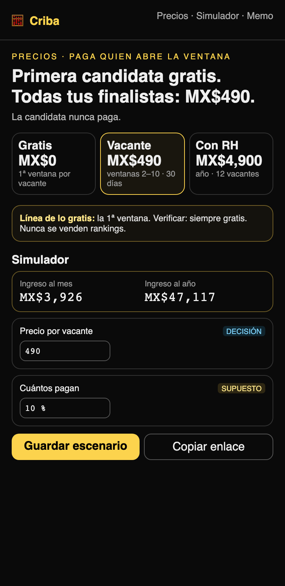
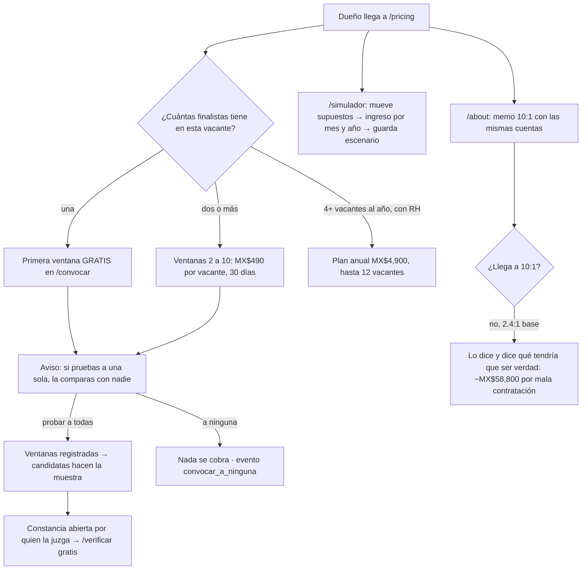
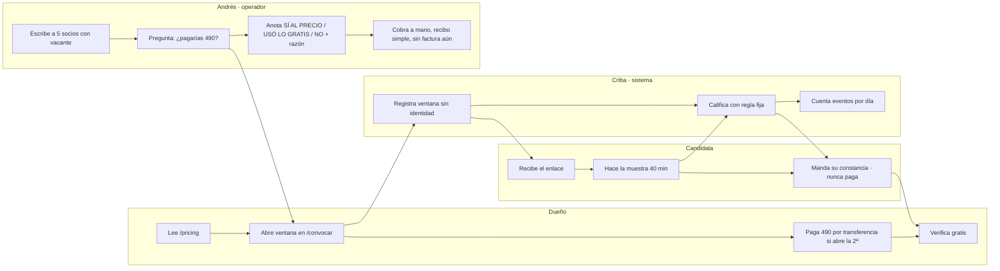

# PACKET — Criba · Semana 14 · PRICING: el número que dice la verdad

> Packet antes del código (2026-11-10). Viene del Brain Bending de hoy (`w14-fight/BRIEF_andres.md`, lente USER, T1). Los packets anteriores están en `PACKET-w04.md` y `PACKET-w13.md`. El Blueprint T1 todavía no existe, así que construyo lo que sobrevivió del brief. Cuando llegue el Blueprint, reviso sus condiciones contra esta página y contra la app.

## El problema, en mis palabras
Criba no tiene precio y sin precio es un pasatiempo con URL. Además, el único número de usuario que tengo medido es 0 de 20: nunca le pedí nada a nadie. Esta semana Criba dice en voz alta cuánto cuesta, quién paga, dónde está la línea de lo gratis y si el 10 a 1 aguanta frente a lo que el dueño hace hoy. Esto último incluye decir que **no aguanta** si los números no dan.

## Usuario exacto
- **Usuario y pagador de record:** el socio o dueño de un despacho contable de 1–20 personas, sin RH, con una vacante de auxiliar contable abierta y 3 o más finalistas. Hoy se entera de si la junior sirve pagándole el **periodo de prueba** (LFT art. 39-A, hasta 30 días).
- **Segmento 2 (supuesto, ningún usuario visto):** despacho de 21–50 personas con alguien de RH que contrata 4 o más veces al año.
- **Quien nunca paga:** la candidata, ni por la muestra ni por su constancia.

## Definición de éxito (antes de que cierre el módulo)
1. **`/pricing` en vivo:** 3 tiers (Gratis · Por vacante · Despacho con RH), 2 segmentos y la línea de lo gratis explicada: la primera ventana de cada vacante es gratis.
2. **`/simulador` en vivo:** clientes × conversión × vacantes × precio → ingresos mensuales y anuales, menos el costo fijo de validar sets. Los supuestos se ven, cada uno marcado como **medido** o **supuesto**. **Escenarios guardados** (en el navegador y como enlace para compartir). Trae tres escenarios de fábrica, y el "Base" es exactamente el del memo.
3. **`/about` con el memo 10:1 (1 página):** lo que el dueño hace hoy, lo que le cuesta (dinero + tiempo + riesgo), mi precio, el ratio calculado **con las mismas funciones del simulador** (2.4:1 en el caso base), la sensibilidad y qué tendría que ser verdad para que llegue a 10.
4. **La conversación real de precio:** su lugar en /about con la regla escrita antes y el estado honesto (**PENDIENTE** hasta que exista). Nunca se llena con un ejemplo inventado.
5. **`/convocar`:** precio escrito junto a la decisión y el aviso "si pruebas a una sola, la comparas con nadie", con un botón **"a ninguna"** del mismo tamaño. Esa elección se cuenta en el log sin identidad.
6. Un bug encontrado y corregido en el pase mecánico, un fix de la prueba de persona y redeploy.

## Mockup (generado)

*Render generado a partir de una descripción de pantalla (HTML → PNG), a 390 px: tres tarjetas de precio arriba, la línea de lo gratis en ámbar y el simulador con supuestos etiquetados.*

## Flujo

**Carriles: quién hace qué**

## Benchmark
- **Lo mejor que existe en el mundo para esto es** TestGorilla: paga el empleador, la candidata nunca, el plan gratis es el anzuelo y Core cuesta US$215/mes.
- **Criba se diferencia o localiza en** que cobra **por vacante** y no por mes (un despacho de 3 contrata una o dos veces al año), en español y con CFDI 4.0, y en que la línea de lo gratis está en la **primera candidata de cada vacante** para que nadie se quede sin registro porque el despacho no pagó.

## Vista larga (3 oraciones)
Si esta rebanada funciona, en tres años Criba es la ventana que un despacho abre antes del periodo de prueba, cobrada por vacante, con sets de CFDIs rotados y validados por contadores a los que se les paga. La candidata nunca paga, y eso es un muro de carga, no una promoción. La verificación es gratis para cualquiera, y el ingreso sale solo de quien duda de la candidata y abre la ventana.

## Lo que NO construyo esta semana
- **Cobro en línea, link de pago o factura (CFDI):** no hay RFC con actividad ni PAC. La página lo dice: recibo simple, transferencia, a mano.
- **Paywall en /convocar:** el sitio muestra el precio, pero no bloquea la segunda ventana mientras no exista forma honesta de cobrar.
- **Cuentas y login:** los escenarios guardados viven en el navegador y en el enlace, sin datos personales, así que no se necesita auth.
- **Ningún "ejemplo" inventado de la conversación de precio**, y nada de sesiones simuladas presentadas como reales.
- Rotación real de sets (v0.2) y dominio propio (decisión de dinero de Andrés).

## Arquitectura y stack

| Pieza | Qué | Por qué |
|---|---|---|
| `lib/precios.js` | Tiers, segmentos, supuestos (valor, unidad, fuente, medido/supuesto), `simular()`, `ratio()`, `sensibilidad()`, codificar/decodificar escenarios con validación y topes | Una sola fuente de verdad: /pricing, /simulador y /about leen las mismas cuentas (lo exige la aclaración del curso) |
| `/pricing` (server) | Tarjetas + línea de lo gratis + segmentos | Estática, rápida en celular |
| `/simulador` (client) | Entradas con rango, salidas mes/año, tabla de supuestos, escenarios en `localStorage` + `?e=` | La lógica corre en el navegador y no se guarda nada en servidor |
| `/about` (server) | Memo 10:1 calculado con `ratio()` + sensibilidad + conversación real (de `lib/conversaciones.js`, hoy vacío → PENDIENTE) | Lo que no está medido se ve como no medido |
| `/convocar` | Precio junto a la decisión + aviso + botón "a ninguna" del mismo tamaño | Condición sombra visible donde se decide |
| `lib/eventos.js` | +5 eventos en la lista cerrada: `pricing_visto`, `simulador_visto`, `escenario_guardado`, `about_visto`, `convocar_a_ninguna` | Medir sin identidad |
| Stack | Next.js 15 + Tailwind 4, Vercel (gratis), Vercel Blob (ya existente), `node --test`, Playwright | Mismo stack, gratis |

**Piso de seguridad:** no hay secretos en el repo (`.env*` en .gitignore). No se guardan datos personales nuevos, así que no hace falta auth ni RLS. Los escenarios del `?e=` se validan con lista blanca de llaves, tipos y topes, y una entrada mala cae al escenario base. Los datos son inventados y así se etiquetan.

## Plan de pruebas
1. **Unit (`node --test`):** `simular()` con el caso base da los ingresos esperados a mano. `ratio()` del caso base da 2.4 (1,167/490) y el umbral de 10:1 da ≈58,800. Un escenario codificado y decodificado sale idéntico. Una entrada con llave extra, texto, negativo o `Infinity` cae al tope o al base. Conversión >100% se rechaza.
2. **E2E (Playwright, 390 px):** /pricing muestra 3 tiers y "la candidata nunca paga". El simulador cambia el ingreso al mover el precio. Guardar escenario → recargar → sigue ahí. El enlace compartido reproduce el escenario. /about muestra 2.4 y el mismo número que el simulador en "Base". /about dice PENDIENTE en la conversación real. /convocar muestra el botón "a ninguna" del mismo tamaño que "probar a todas". No hay scroll horizontal.
3. **Prueba de persona (capa 1):** un dueño de despacho sintético recorre /pricing → /simulador → /about en capturas a 390 px. Se registran todas sus confusiones y se corrige la peor. Se etiqueta como sintético.
